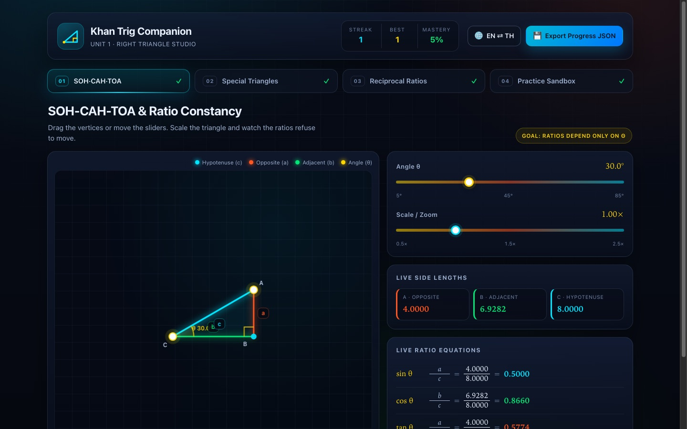

# Khan Trig Companion · Unit 1 Right Triangle Studio

An interactive, bilingual companion for **Khan Academy Trigonometry, Unit 1: Right Triangles & Trigonometry**. Instead of reading equations, students drag vertices, scale triangles, flip reciprocal ratios, and drill generated problems — all in one offline HTML page with zero dependencies.

**Version 1.0.0** · [Live demo](https://somphol.github.io/khan-trig-unit1-right-triangle-studio/) · MIT · No build step



## The four studios

| # | Module | What it teaches |
|---|--------|-----------------|
| 01 | **SOH-CAH-TOA & Ratio Constancy** | Draggable right triangle, angle and scale sliders, live 4-decimal ratios. Scaling proves the ratios depend only on θ. |
| 02 | **Special Right Triangles** | 45°-45°-90° and 30°-60°-90° with exact radical labels (`x`, `x√2`, `x√3`, `2x`) and decimal values side by side. |
| 03 | **Reciprocal Ratios & Duality** | sin ↔ csc, cos ↔ sec, tan ↔ cot cards with undefined-state warnings at 0° and 90°. |
| 04 | **Khan Practice Sandbox** | Ratio, missing-side and real-world story problems; streak, mastery bar, badges, and animated step-by-step solutions. |

## Features

- **Semantic colour system** — hypotenuse cyan, opposite coral, adjacent emerald, angle yellow, reused in every module.
- **Bilingual HUD (EN ⇄ TH)** — every label, instruction, formula title and story problem switches language, including Thai maths terminology (ด้านตรงข้ามมุมฉาก, ด้านข้าม, ด้านชิด).
- **Live LaTeX-style fractions** — stacked fractions with tabular figures, updated on every input.
- **Canvas geometry** — HiDPI-aware rendering, vertex dragging, angle arcs, right-angle marks and responsive resizing.
- **Progress persistence** — streak, best streak, correct counts, completed modules and settings are saved to `localStorage` and restored on reload.
- **Export** — `💾 Export Progress JSON` downloads `khan_trig_unit1_progress.json`.
- **Accessibility** — labelled controls, keyboard-navigable tabs, visible focus rings, ARIA live feedback, reduced-motion support. Sliders provide a non-pointer alternative to dragging.
- **Offline and static** — no frameworks, no CDN, no fonts to download, no network requests at runtime.

## Run locally

No install and no build step.

```bash
git clone https://github.com/somphol/khan-trig-unit1-right-triangle-studio.git
cd khan-trig-unit1-right-triangle-studio
python3 -m http.server 8080
```

Open <http://localhost:8080>. Opening `index.html` directly from Finder also works; the app only needs `file://` access to its local assets.

## Documentation

| Document | Purpose |
|----------|---------|
| [docs/ARCHITECTURE.md](docs/ARCHITECTURE.md) | State model, canvas contract, geometry, i18n, extension recipes |
| [docs/DESIGN.md](docs/DESIGN.md) | Pedagogy, colour matrix, Thai glossary, interaction decisions |
| [docs/TESTING.md](docs/TESTING.md) | Automated checks, verified matrix, manual regression list |
| [docs/DEPLOYMENT.md](docs/DEPLOYMENT.md) | GitHub Pages setup, verification, rollback, custom domain |
| [docs/ACCESSIBILITY.md](docs/ACCESSIBILITY.md) | WCAG target, implemented features, known gaps |
| [docs/RELEASE.md](docs/RELEASE.md) | Versioning, release checklist, hotfix and rollback |
| [CONTRIBUTING.md](CONTRIBUTING.md) | Ground rules, local setup, PR expectations |
| [CODE_OF_CONDUCT.md](CODE_OF_CONDUCT.md) | Contributor Covenant 2.1 |
| [SECURITY.md](SECURITY.md) | Supported versions, private reporting, scope |
| [SUPPORT.md](SUPPORT.md) | Common fixes and where to ask |
| [ROADMAP.md](ROADMAP.md) | Shipped work, candidates, non-goals |
| [CHANGELOG.md](CHANGELOG.md) | Release history |
| [state.json](state.json) | Build record: time, tokens and credits |
| [AGENTS.md](AGENTS.md) | Operating notes for the next developer or agent |

## Quality gates

```bash
node --check script.js      # JavaScript syntax
node scripts/check.mjs      # files, ids, i18n parity, colours, links, state
```

Both run in GitHub Actions on every push and pull request. The checker has no dependencies and verifies that the English and Thai dictionaries stay in sync, every referenced DOM id exists, local assets resolve, and runtime code contains no network APIs.

## Project structure

```
index.html                 Markup for the HUD, four panels and bilingual hooks
style.css                  Palette, layout, responsive rules, sliders, fractions
script.js                  State, i18n, canvas engines, generator, export
scripts/check.mjs          Dependency-free static release checks
docs/                      Architecture, design, testing, deployment, a11y, release
.github/                   CI, issue templates, PR template, CODEOWNERS
state.json                 Build record: elapsed time, token usage, credits
AGENTS.md                  Operating notes for the next developer or agent
assets/hero.jpg            Documentation screenshot only
```

## Data and privacy

Everything stays in the browser. The only storage is `localStorage["khanTrigUnit1.v1"]` (language, settings, streak, badge list). The export button creates a local Blob; nothing is uploaded. Clearing site data resets the studio.

## Contributing

Issues and pull requests are welcome. Read [CONTRIBUTING.md](CONTRIBUTING.md) and keep the project static, offline and bilingual. Report vulnerabilities privately per [SECURITY.md](SECURITY.md).

## Credits

Built in a single session with **[OpenCode](https://opencode.ai)** running **DeepSeek V4.1 Flash** (`opencode-go/deepseek-v4.1-flash`). Exact elapsed time and token consumption are recorded in [`state.json`](state.json).

## Licence

MIT — see [LICENSE](LICENSE).
